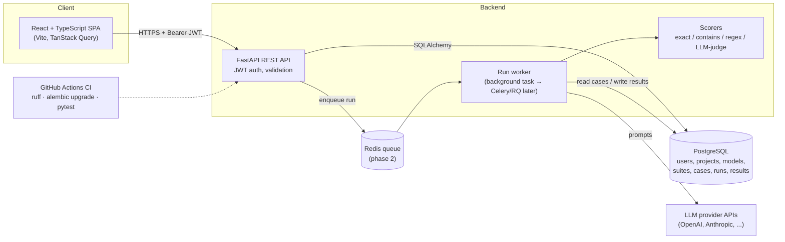
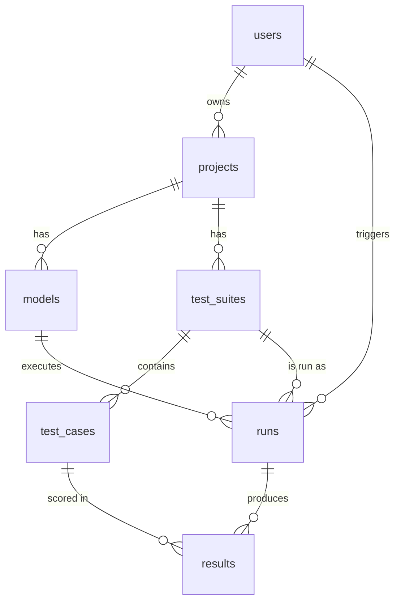

# EvalForge — Product Spec (v0.1)

**One-liner:** A regression-testing workbench for LLM-powered features. Define a suite of prompts with
expected behaviour, run it against a model, and see exactly what got better or worse versus the last run.

## 1. Problem
Prompt or model changes silently break behaviour. AI engineers currently check by eyeballing
outputs or maintaining ad-hoc scripts. They need repeatable suites and a clear "what changed" view.

## 2. Users
**Primary:** AI/ML engineer shipping an LLM feature (changes prompts, swaps models, tunes parameters).

## 3. User stories & acceptance criteria

### US-1 Define a suite
*As an AI engineer, I want to create a project, register the model(s) I use, and define a test suite of cases so that I can re-run the same checks whenever something changes.*
- Create a project; add a model config (provider, model id, params such as temperature).
- Create a suite inside a project; add/edit/delete test cases.
- A test case has: name, prompt, expected output (optional), scorer (`exact_match`, `contains`, `regex`, `llm_judge`), pass threshold.
- Suite names are unique per project; only the project owner can see/edit.

### US-2 Run a suite
*As an AI engineer, I want to run a suite against a chosen model so that I get scored results I can trust.*
- Select suite + model, click Run. A run is created with status `queued → running → completed | failed`.
- Each case produces a result: model output, score (0–1), pass/fail, latency, error (if any).
- One failing case (timeout, API error) must not abort the run; it is recorded in `results.error`.
- Run summary shows pass rate, mean score, p50/p95 latency.

### US-3 Read a regression diff
*As an AI engineer, I want to compare two runs of the same suite so that I can see which cases regressed, improved, or stayed the same.*
- Pick a baseline run and a candidate run (default: previous completed run vs latest).
- Each case is classified: **regressed** (pass→fail or score drop > ε), **improved**, **unchanged**, **new**, **removed**.
- Regressions are listed first; clicking a case shows baseline vs candidate output side by side.
- Header summary: "N regressed, M improved, K unchanged" + pass-rate delta.

### US-0 Account (enabler)
- Sign up with email + password; log in; receive a JWT; every other endpoint requires it.

## 4. Scope
**MVP (this internship):** US-0, US-1, US-2, US-3, web UI, one LLM provider adapter.
**Out of scope for v1:** teams/orgs & RBAC, scheduled runs, CI webhook, cost tracking, dataset import from CSV.

## 5. Non-functional requirements
- Passwords hashed with bcrypt; JWT HS256, 60 min expiry; secrets only via env vars.
- Runs execute asynchronously (worker) so the API never blocks on LLM calls.
- Every push runs lint, migrations against real Postgres, and tests.

## 6. Architecture



## 7. Data model



Key constraints: `results (run_id, test_case_id)` unique; `runs.status` CHECK in
(queued, running, completed, failed); `runs.model_id` has no cascade (NO ACTION), so a model with run history cannot be deleted (API returns 409).

**Regression diff query (core of US-3):**
```sql
SELECT tc.id, tc.name,
       b.passed AS base_passed, c.passed AS cand_passed,
       b.score  AS base_score,  c.score  AS cand_score
FROM test_cases tc
LEFT JOIN results b ON b.test_case_id = tc.id AND b.run_id = :baseline
LEFT JOIN results c ON c.test_case_id = tc.id AND c.run_id = :candidate
WHERE tc.suite_id = :suite
  AND (b.id IS NOT NULL OR c.id IS NOT NULL);
```

## 8. API
| Method | Path | Notes |
|---|---|---|
| POST | /auth/signup, /auth/login | public |
| GET | /auth/me | current user |
| GET/POST | /projects | list / create |
| GET/PUT/DELETE | /projects/{id} | owner only; foreign ids return 404 |
| GET/POST | /projects/{id}/models | model configs; DELETE /models/{id} |
| GET/POST | /projects/{id}/suites | GET/DELETE /suites/{id} |
| GET/POST | /suites/{id}/cases | PUT/DELETE /cases/{id} |
| POST | /suites/{id}/runs | returns 202, run executes in background |
| GET | /suites/{id}/runs | run history |
| GET | /runs/{id} | status + summary + per-case results |
| GET | /suites/{id}/diff?baseline=&candidate= | omit both to compare the latest two completed runs |

Diff statuses: `regressed` (pass→fail or score drop > 0.05), `improved`, `unchanged`,
`new` (case only in candidate), `missing` (case only in baseline, e.g. candidate run failed midway).

## 9. Milestones — all done
1. ✅ Spec, repo, CI, schema, auth
2. ✅ CRUD for projects / models / suites / cases with ownership checks
3. ✅ Run engine (background task), providers (mock/OpenAI/Anthropic), scorers
4. ✅ Diff endpoint + tests
5. ✅ React UI (login, projects, suite editor, run view, diff view)
6. ✅ Docker, seed script, README

## 10. Known limitations / future work
- Runs use FastAPI BackgroundTasks (in-process). For production move to Redis + Celery/RQ so runs survive restarts.
- `llm_judge` uses the model under test as its own judge; a separate judge-model setting would be better.
- Cases run sequentially; add concurrency + rate-limit handling for large suites.
- No refresh tokens or password reset; JWT is stored in localStorage (acceptable for an internal tool, not ideal for public use).
